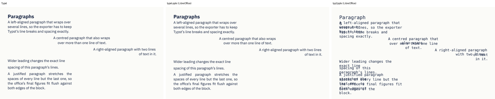
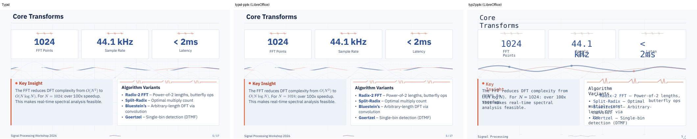
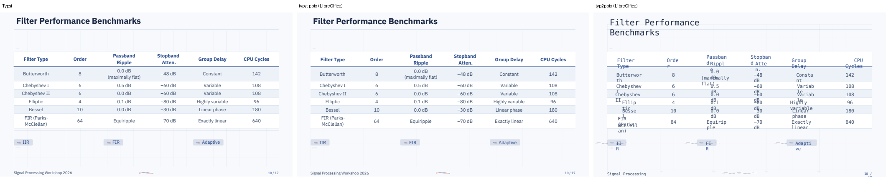
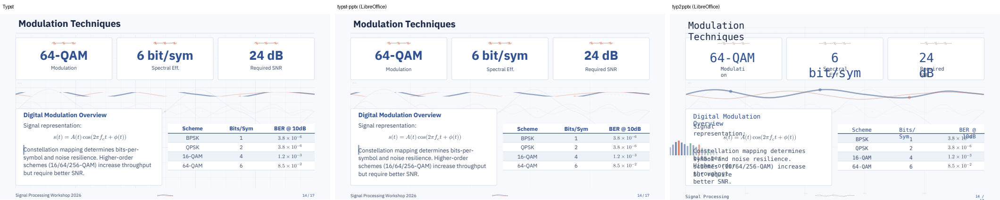

# Prior art: typ2pptx

Comparison with [typ2pptx](https://github.com/touying-typ/typ2pptx), the
existing Typst/Touying → PowerPoint converter (Python, MIT, in the Touying
GitHub organisation). Measured on 2026-10-21 with typ2pptx **0.2.3** (latest
on PyPI) and typst-pptx **0.1.0**, on this repository's fixture decks.
Reproduce with `tools/prior-art/typ2pptx.sh` (devcontainer, after
`cargo build --release`).

## Approach

| | typ2pptx | typst-pptx |
|---|---|---|
| Input to the converter | SVG from a bundled `typst-ts-cli` (Typst 0.14.2) | Typst's laid-out document (frames, tags, introspector), Typst 0.15.1 as a library |
| Fonts | not in the SVG: style guessed from glyph outlines, mapped to Arial / Consolas / Cambria Math | the fonts Typst used, embedded in the `.pptx` |
| Paragraphs | one text box per visual line (paragraph detection is opt-in, "prone to misclassifying" tables) | one box per paragraph with Typst's line breaks, spacing modelled per application |
| Tables, lists | lines and loose text | native `a:tbl`, native bullets and numbering |
| Distribution | `pip install typ2pptx` | static binaries (4 Linux targets), CLI contract for tino |

An SVG carries glyphs and paths only: no font names, paragraphs, table cells
or list items. Those have to be guessed back, which is where most of the
differences below come from. Fixing them in typ2pptx would mean replacing its
input, i.e. rebuilding it around Typst's layout as typst-pptx does.

## Results on the fixture decks

| | typ2pptx 0.2.3 | typst-pptx 0.1.0 |
|---|---|---|
| Touying 0.8 decks (fixtures, tino) | **fail**: "package requires Typst 0.15.0 or newer"; copies pinned to Touying 0.7.4 were used below | work |
| Fonts | every text run **Consolas**, bold lost (see below) | IBM Plex Sans/Mono as in Typst, embedded |
| Demo deck (17 slides) | 293 text boxes, 0 tables, 0 native bullets | 182 text boxes, 2 tables, 31 native bullets |
| Hyperlinks (features deck) | 1 | 3 (incl. links between slides) |
| Errors | Python traceback with typst-ts-cli's stderr | Typst diagnostics with file:line, exit codes 0/1/2, `report.json` |
| Checked in desktop PowerPoint | no | yes, Windows milestones: text within ~0.5 pt of Typst |

Why Consolas: typ2pptx classifies glyphs drawn with quadratic curves as
monospace (`typst_svg_parser.py`, "Quadratic curves (Q commands) → mono or
math font"). TrueType fonts (IBM Plex, Roboto, Inter, most theme fonts) all
use quadratic outlines, so their text becomes Consolas; only CFF fonts such
as Typst's default Libertinus avoid it. Even when the guess is right, the
best case is Arial in place of the theme font, and since each line is its own
box sized for the original font, lines overflow or overlap.

## Screenshots

Typst | typst-pptx | typ2pptx, all three `.pptx` rendered by LibreOffice.
Consolas isn't installed there, so typ2pptx's text is drawn with a substitute
monospace font; in PowerPoint the overlaps differ in detail, but the font,
the lost bold and the per-line boxes are in the file.

Paragraphs (features slide 2):

Lists (features slide 3):

Cards and lists (demo slide 5):

Table (demo slide 10):

Maths in text and a table (demo slide 14):

## Where typ2pptx is ahead

- **Maths**: inline maths as editable Cambria Math text, display maths as
  vector glyph shapes. typst-pptx exports equations as pictures; glyph
  outlines as shapes are worth adopting (slide 14 above).
- **Reach**: maintained in the Touying organisation, one-line install, no
  native build.
- Neither has click animations yet (typst-pptx: Phase 4).

## Conclusion

Same goal, different input. typ2pptx's current release can't open Touying
0.8 decks, and the fidelity gaps (fonts, paragraphs, tables, lists) follow
from converting SVG rather than Typst's layout, so they aren't fixable by a
patch. typst-pptx is not a duplicate; contact with the Touying maintainers is
still worthwhile (shared fixtures, the maths approach, pointing users to the
right tool).
